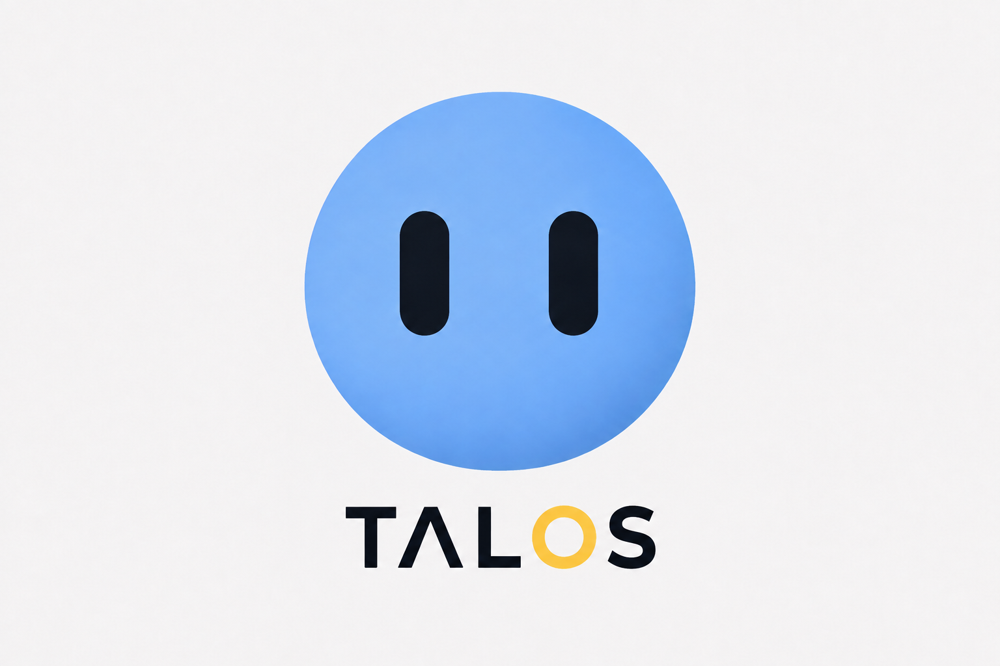
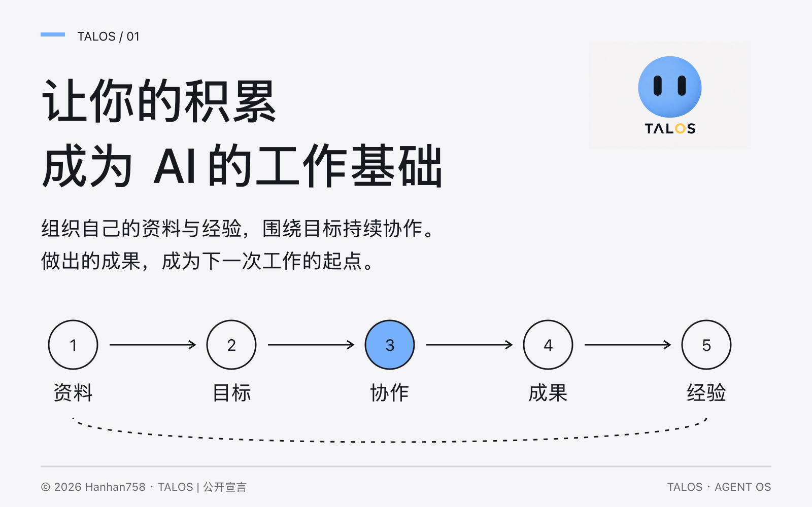
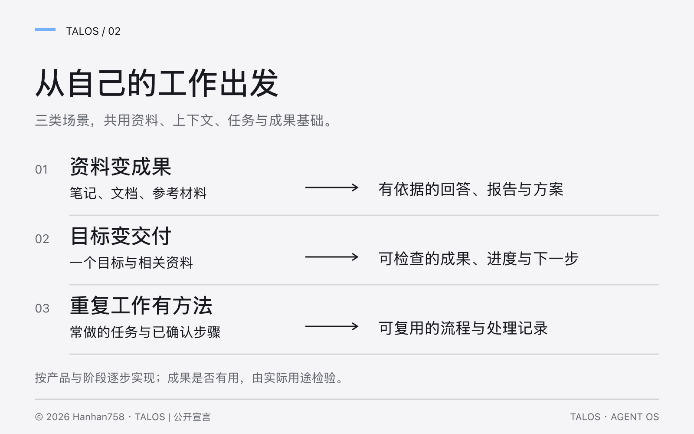
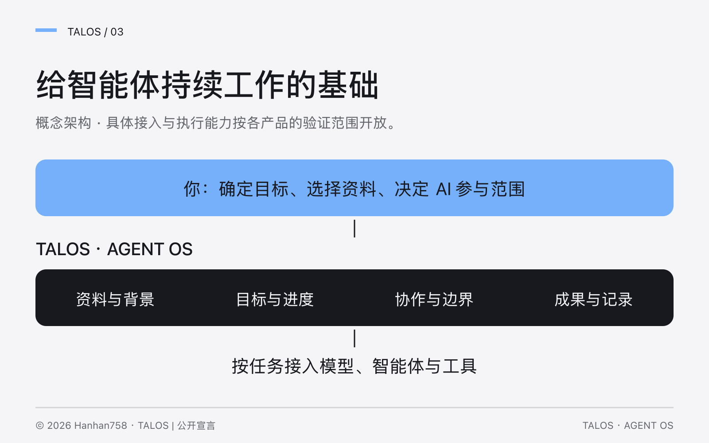
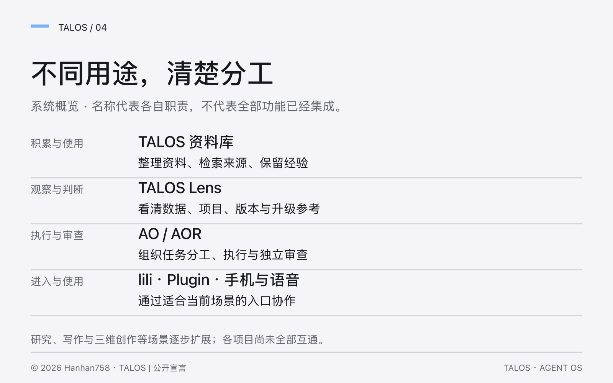
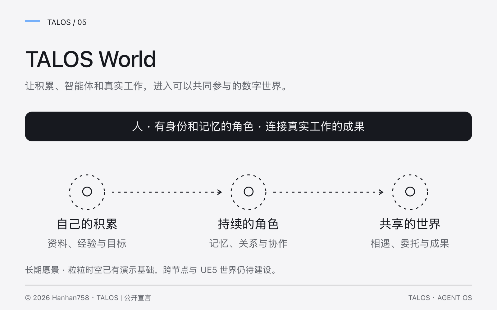
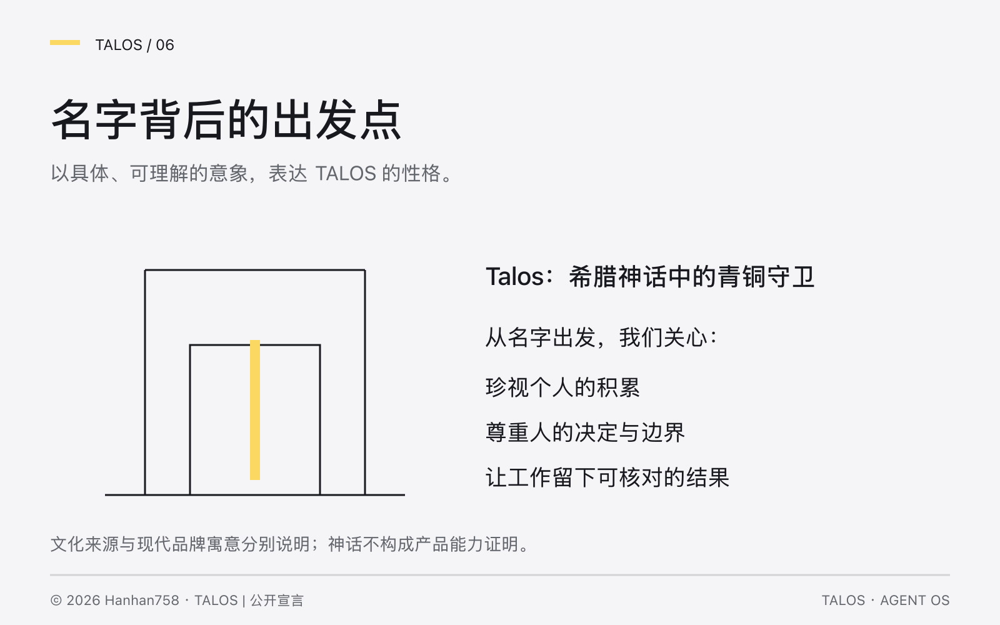

# TALOS · Agent OS

**以自己的资料、目标和经验为基础，组织人与智能体持续工作的系统。**

[核心宣言](docs/manifesto.md) · [系统与应用](docs/system-map.md) · [TALOS World](docs/world.md) · [当前阶段](docs/status.md) · [名称来源](docs/origins.md)

© 2026 Hanhan758（外脑玩家）。原创表达保留权利；本仓库为公开阅读项目，未授予开放许可。适用例外、平台权利及授权联系见[权利声明](NOTICE.md)，版本与文件核对见[来源记录](PROVENANCE.md)。

TALOS 从长期真实使用中生长：整理自己的资料，明确正在做的事，与大模型协作，把有用的成果和经验留下。每次工作，都能为下一次积累基础。

它面向已经开始使用 AI、希望把资料和实际工作连接起来的人，也逐步探索组织协作。学习、配置和使用的方法随具体任务展开。

> **当前阶段 · 2026-09-10**：本仓库公开理念、系统关系与发展方向。TALOS 已有本机应用、使用实例和工程候选，各部分成熟度不同；完整系统尚未全部贯通。这里暂不提供模板、源码或安装包。详见[阶段说明](docs/status.md)。

## 能帮助我做什么？

| 从什么开始 | 希望获得什么 |
|---|---|
| 一组笔记、文档或参考材料 | 有资料依据的回答、报告、方案或内容 |
| 一个需要推进的目标 | 可检查的成果，清楚的进度、决定与下一步 |
| 一项经常重复的工作 | 可复用的处理流程、结果与异常记录 |

资料、知识、偏好、经验、目标、项目、流程和成果，都是系统关注的管理对象。具体支持范围随产品与阶段说明，效果需要在实际工作中检验。

## 为什么叫 Agent OS？

这里的 **Agent OS** 是一套组织智能体工作的架构理念：让 AI 知道当前目标、用上相关资料、遵循已确认的规则，并留下能够接续的工作记录。

用户选择模型、工具和 AI 参与范围。事实、建议与人的决定分别保留；成果是否完成，要回到实际用途与检查结果。具体兼容能力按版本确认。

## 一套基础，不同用途

| 组成 | 用途 |
|---|---|
| **TALOS 资料库** | 整理资料、检索来源、积累经确认的经验与偏好 |
| **TALOS Lens** | 图形化了解数据、项目、版本状态与升级参考 |
| **AO / AOR** | 组织智能体任务分工、执行与独立审查 |
| **lili、TALOS Plugin** | 桌面工作台与 Obsidian 内的使用入口 |
| **手机、语音与设备操作探索** | 在不同场景下进入和使用工作系统 |
| **研究、写作与三维创作场景** | 用共同方法完成具体的专业工作 |

各项目保有自己的职责、数据归属与验证范围，尚未全部互通。可以在[系统与应用](docs/system-map.md)中了解它们的关系。

## 走向 TALOS World

我们希望，人能够进入一个持续存在的数字世界，与拥有身份、记忆、关系和能力的智能体相遇、协作。现实任务的成果可以成为世界的一部分，已有积累也能支持新的行动。

长期探索由不同用户或组织保有数据与模型选择，通过共同规则连接。粒粒时空已有 Web 演示基础；跨节点协作、真实能力接入和 UE5 世界仍需逐阶段建设。[阅读 World 愿景](docs/world.md)。

## 为什么是 TALOS？

名字取意于希腊神话中的 Talos 青铜守卫。我们从中发展自己的品牌表达：珍视人的积累，尊重人的决定，让工作有清楚的边界与可核对的结果。神话背景与现代寓意分别说明。[文化来源与原典](docs/origins.md)。

## 关注与交流

如果你也在探索怎样管理自己的资料、推进工作和用好 AI，可以关注本仓库的后续更新，或通过 [Issues](https://github.com/Hanhan758/talos-agent-os/issues) 描述具体的使用问题。请使用可公开的示例。

[早期 TALOS Framework](https://github.com/Hanhan758/talos-framework) 保留其论文、版本、模板和许可历史。本仓库从当前系统出发重新说明理念；它不改变其他仓库的许可和产品状态。

## English

TALOS organizes personal knowledge, goals and experience into a lasting foundation for working with AI agents. Agent OS describes the architecture: relevant context, clear goals, human control, continued work and reviewable outcomes. This repository presents the ideas, application relationships and TALOS World vision. Individual implementations are at different stages; the full system is still being developed and validated. No implementation code or templates are distributed here.

阅读与使用边界见 [NOTICE](NOTICE.md)。
